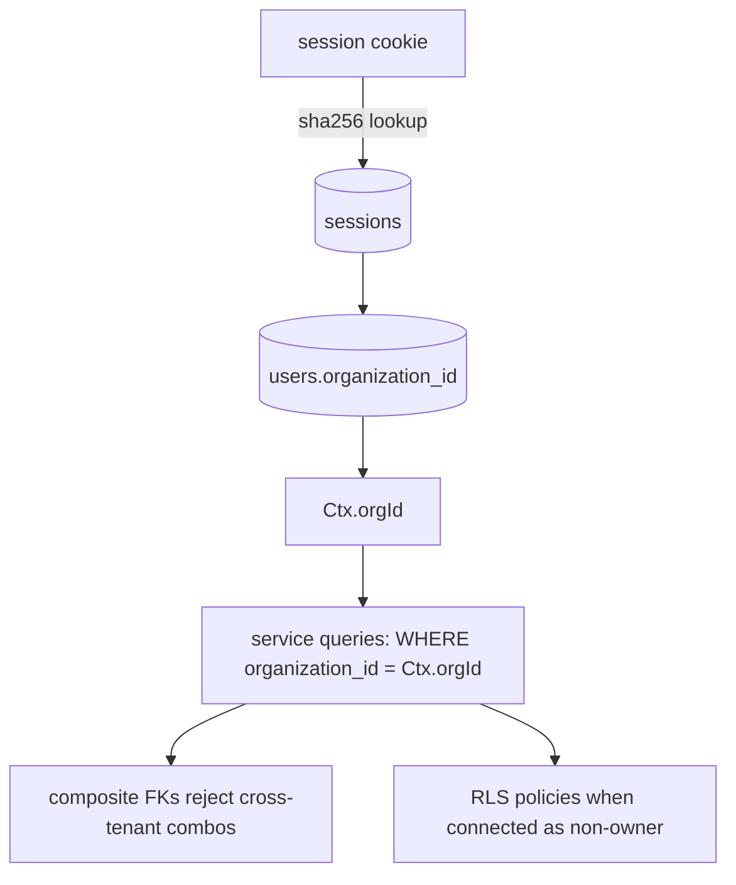
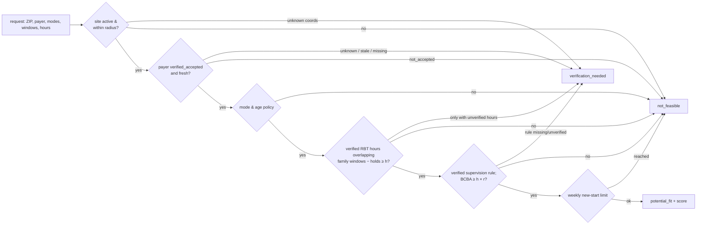
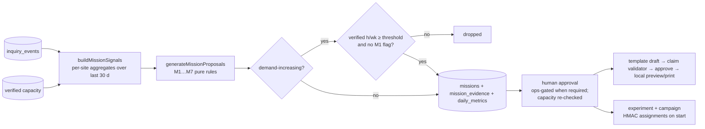

# Architecture

## Services and data flow

```mermaid
flowchart LR
  subgraph Browser
    UI[Next.js pages<br/>server components + client islands]
  end
  subgraph "apps/web (Node runtime)"
    MW[middleware<br/>cookie gate] --> UI
    API["/api/v1 route handlers<br/>route(): session · RBAC · CSRF · rate limit · Zod · error envelope"]
  end
  subgraph "packages/db (tenant-scoped services)"
    SVC[services/*<br/>every call takes Ctx{orgId,userId,role}]
    MET[metrics.ts<br/>KPIs as SQL over inquiry_events]
    SEED[seed + reset]
  end
  subgraph "packages/core (pure)"
    MATCH[matching.ts]
    RULES[missions.ts]
    STATS[experiments.ts · stats.ts]
    CONTENT[content.ts<br/>templates + claim validator]
  end
  subgraph "packages/connectors"
    ACS[ACS adapter]
    LLM[LLM adapter<br/>offline by default]
    DEL[Delivery: send() throws]
  end
  PG[(PostgreSQL 16<br/>composite tenant FKs · RLS · immutable triggers)]
  UI -- fetch JSON --> API --> SVC
  UI -- RSC direct calls --> SVC
  SVC --> MATCH & RULES & STATS & CONTENT
  SVC --> MET --> PG
  SVC --> PG
  SVC --> ACS & LLM & DEL
  JOBS[packages/jobs CLI<br/>cron-compatible] --> SVC
```

* **Pages** are server components that call services directly with the session’s `Ctx`; interactive parts are client components that mutate through `/api/v1` and then `router.refresh()`.
* **Route handlers** all go through `route(action, fn)` (`apps/web/src/lib/server/api.ts`): resolve the session from the HttpOnly cookie against the database, reject cross-origin mutations, rate-limit, pre-check the RBAC matrix, run the handler, and map errors to `{error:{code,message,requestId}}`. Unexpected errors log only the error class/code and request id — never bodies.
* **Services** re-check permissions (`assertCan`) so authorization never depends on which entry point was used.
* **Core** is pure and deterministic; it has no I/O and is unit-tested exhaustively.

## Tenancy boundary

Three layers, from strongest to defense-in-depth:

1. **Composite foreign keys** — child tables reference parents by `(organization_id, id)`, so a row can never point at another tenant’s center, payer, inquiry, mission, experiment or variant (tested: `tenancy.test.ts`).
2. **Service-level scoping** — every query filters `organization_id = ctx.orgId`; lookups by UUID return `NOT_FOUND` for other tenants (tested by guessing UUIDs across Harbor ↔ Lakeside).
3. **Row-level security** — `tenant_isolation` policies on all tenant tables keyed on `app.current_org`. The dev app connects as the table owner (which bypasses RLS); production must connect as a non-owner role and `set_config('app.current_org', …)` per transaction. A test proves the policies isolate a non-owner role.



## Event model

`inquiries` holds the current projection; `inquiry_events` is the immutable source of truth:

* One event per transition (`eventTypeForTransition`), with `previous_stage`/`next_stage`, actor, `schema_version`, metadata and a per-tenant unique **idempotency key**.
* Partial unique indexes: one `inquiry_created` and at most one `care_started_verified_by_staff` per inquiry.
* Triggers: UPDATE/DELETE forbidden (`IMMUTABLE_RECORD`) except the documented purge path (demo reset sets `careflow.allow_purge` for its own transaction); events cannot predate the inquiry or be in the future (`EVENT_ORDER`).
* `audit_logs` has the same immutability trigger. Non-inquiry domain events (`mission_approved`, `experiment_started`, `experiment_completed`) are written to the audit log.

## Matching trace



Score (potential fits only): `100 × (0.35·schedule coverage + 0.25·capacity + 0.20·distance + 0.20·backlog)`, each in [0,1]; ties broken by center id. Capacity uses interval-overlap summation with uniform spread of available hours across a window; same role/day/mode windows are validated non-overlapping on save so summation is reproducible. The matcher never reads reimbursement, severity or demographics.

## Mission rule trace



Dedupe key: `center:rule:ISO-week`. Re-generation refreshes evidence only for still-proposed missions; reviewed missions keep the evidence they were approved on.

## Key files

| Concern | File |
|---|---|
| Schema / migrations | `packages/db/src/schema.ts`, `packages/db/drizzle/*.sql` |
| KPIs (SQL) | `packages/db/src/services/metrics.ts` |
| Matcher | `packages/core/src/matching.ts` |
| Mission rules | `packages/core/src/missions.ts` |
| Experiment stats | `packages/core/src/experiments.ts`, `stats.ts` |
| Drafts & validator | `packages/core/src/content.ts`, `packages/db/src/services/drafts.ts` |
| Seed story | `packages/db/src/seed/{fixtures,simulate,index}.ts` |
| API wrapper | `apps/web/src/lib/server/api.ts` |
